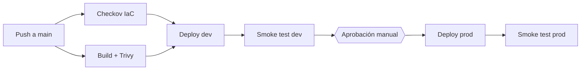

# Taller 4: Dos ambientes (dev/prod) con aprobación para producción

Proyecto del segundo parcial de **Infraestructura para TI** (Universidad Tecnológica de Bolívar), equipo **LOS EGOÍSTAS**.

Una aplicación Node.js en contenedor que se despliega en **Azure** en dos ambientes aislados, **dev** y **prod**. Todo se define como código con **Terraform** y se entrega con **GitHub Actions**. El despliegue a dev es automático; el de producción **se pausa hasta que un revisor lo apruebe**.

## Arquitectura



Cada ambiente tiene su propio Resource Group, su propio estado de Terraform y su propia identidad de despliegue:

| Recurso | Detalle |
|---|---|
| Azure Container Registry | SKU Basic, un ACR por ambiente, sin usuario admin |
| App Service Plan (Linux) | SKU B1 (en un caso real: P1v3 o superior para prod) |
| Linux Web App | Contenedor, HTTPS only, TLS 1.2, health check en `/health`, identidad administrada |
| Backend de Terraform | Storage Account con versionado y un contenedor de estado por ambiente (`tfstate-dev`, `tfstate-prod`) |
| Autenticación | OIDC con credenciales federadas: sin secretos de larga duración en GitHub |

## Estructura del repositorio

```
.
├── .github/workflows/
│   ├── deploy.yml          # Pipeline principal: seguridad, build, dev, aprobación, prod
│   └── _deploy-env.yml     # Workflow reutilizable que despliega un ambiente
├── app/                    # Aplicación Node.js + Dockerfile
├── infra/
│   ├── main.tf             # Módulo raíz
│   ├── modules/webapp/     # ACR + App Service Plan + Web App + roles
│   └── environments/       # dev.tfvars y prod.tfvars
├── scripts/
│   ├── bootstrap.sh        # Prepara Azure antes de correr el pipeline
│   └── health-check.sh     # Prueba de disponibilidad post-despliegue
└── .checkov.yaml           # Excepciones justificadas de Checkov
```

## Aplicación

Servidor HTTP en Node.js 22 sin dependencias externas.

| Ruta | Descripción |
|---|---|
| `/` | Página HTML con el ambiente, el mensaje y el commit desplegado |
| `/health` | JSON con `status`, `environment`, `version` (SHA del commit), `message` y `secretConfigured` |

El valor del secreto nunca se expone; solo se indica si está configurado.

Ejecución local:

```bash
cd app
docker build -t taller4-app --build-arg GIT_SHA=local .
docker run --rm -p 3000:3000 -e APP_ENV=local -e APP_MESSAGE="Hola" taller4-app
# http://localhost:3000
```

## Pipeline de CI/CD

El workflow `deploy.yml` se ejecuta en cada push y pull request a `main`, y también manualmente.

| Job | Cuándo corre | Qué hace |
|---|---|---|
| `checkov` | PR y push | Escanea el Terraform de `infra/` con Checkov |
| `build-scan` | PR y push | Construye la imagen (tag = SHA del commit) y la escanea con Trivy (falla con vulnerabilidades HIGH/CRITICAL) |
| `deploy-dev` | Solo push a `main` | `terraform init/validate/plan/apply`, publica la imagen en el ACR de dev y actualiza la Web App |
| `smoke-test-dev` | Tras dev | Verifica que `/health` responda con el ambiente y la versión correctos |
| `deploy-prod` | Tras el smoke test de dev | **Pausa hasta aprobación manual** (Environment `prod`) y luego despliega |
| `smoke-test-prod` | Tras prod | Verificación post-despliegue |

La misma imagen (mismo SHA) que se probó en dev es la que llega a producción.

## Puesta en marcha

### 1. Preparar Azure

Requiere Azure CLI autenticado (`az login`), rol **Owner** en la suscripción y permiso para crear App Registrations en Microsoft Entra ID.

```bash
# Edita GITHUB_ORG, GITHUB_REPO, LOCATION y PROJECT dentro del script
bash scripts/bootstrap.sh
```

El script registra los resource providers, crea el backend de Terraform, los Resource Groups de cada ambiente, un Service Principal por ambiente con credencial federada OIDC y los roles mínimos necesarios. Al final guarda los valores que necesitas en `bootstrap-output.txt` (no lo subas al repositorio).

### 2. Crear los Environments en GitHub

En **Settings → Environments** crea dos ambientes con **exactamente** estos nombres (la credencial federada depende de ellos):

* `dev`: sin reglas de protección.
* `prod`: activa **Required reviewers** y agrega a los aprobadores.

### 3. Configurar secrets y variables

Configúralos **dentro de cada Environment**:

| Nombre | Tipo | Valor |
|---|---|---|
| `AZURE_CLIENT_ID` | Secret | `AZURE_CLIENT_ID_dev` o `AZURE_CLIENT_ID_prod` de `bootstrap-output.txt` (distinto por ambiente) |
| `AZURE_TENANT_ID` | Secret | De `bootstrap-output.txt` |
| `AZURE_SUBSCRIPTION_ID` | Secret | De `bootstrap-output.txt` |
| `APP_SECRET` | Secret | Secreto de la aplicación (distinto por ambiente) |
| `APP_MESSAGE` | Variable | Mensaje que muestra la app (distinto por ambiente) |
| `TFSTATE_RG` | Variable | Resource Group del backend de Terraform |
| `TFSTATE_SA` | Variable | Storage Account del backend de Terraform |

### 4. Desplegar

Haz push a `main`. Se despliega dev automáticamente; cuando el smoke test pase, el pipeline quedará esperando la aprobación para producción.

## Seguridad

* **Checkov** analiza el Terraform en cada ejecución. Las excepciones de `.checkov.yaml` están justificadas por el requisito de bajo costo del taller (SKUs Premium, redundancia de zona, red privada, logging de diagnóstico).
* **Trivy** bloquea el pipeline si la imagen tiene vulnerabilidades HIGH/CRITICAL con corrección disponible.
* La imagen corre como usuario no root, sin npm, yarn ni corepack.
* Autenticación OIDC: cada Service Principal solo puede ser usado por su Environment de GitHub y solo tiene permisos sobre su propio Resource Group y su propio contenedor de estado.
* ACR sin usuario admin; la Web App descarga imágenes con su identidad administrada (`AcrPull`).

## Ejecutar Terraform manualmente

```bash
cd infra
terraform init \
  -backend-config="resource_group_name=<TFSTATE_RG>" \
  -backend-config="storage_account_name=<TFSTATE_SA>" \
  -backend-config="container_name=tfstate-dev" \
  -backend-config="key=dev.tfstate"
terraform plan -var-file=environments/dev.tfvars
```

Necesitas `az login` y las variables `ARM_SUBSCRIPTION_ID` y `TF_VAR_app_secret` en tu entorno.

## Costos y limpieza

Cada ambiente usa un App Service Plan B1 y un ACR Basic. Al terminar, destruye los recursos de cada ambiente (inicializando el backend correspondiente como en la sección anterior):

```bash
terraform destroy -var-file=environments/dev.tfvars
terraform destroy -var-file=environments/prod.tfvars
```

## Equipo

**LOS EGOÍSTAS**: 

Curso: Infraestructura para TI, UTB, Cartagena de Indias.